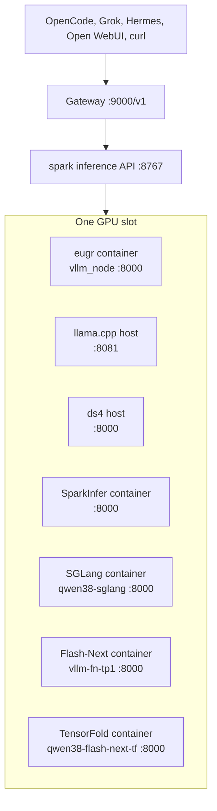
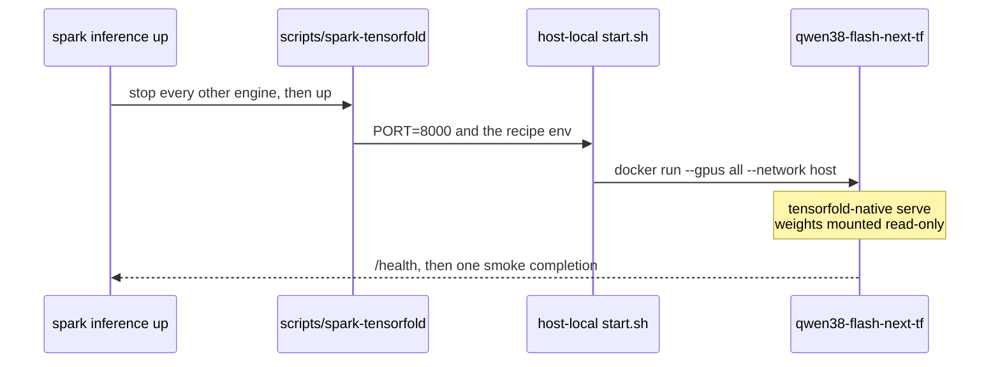

# Inference stack

Control plane for one GPU workload at a time, many logical model names, and a stable client URL.

Portal: http://sparky/ → **Inference**. Gateway: http://sparky:9000/v1.

## Layers

| Layer | Multi-model? | How |
|-------|--------------|-----|
| Gateway / API | Yes | Many ids (`sparky`, `qwen3.6-27b-dflash`, …) |
| Physical GB10 | One heavy slot | One recipe loaded; switch = evict + start |
| Agents | Yes, with swap cost | Request any registered name; cold start returns 503 |

Agents are not locked to one model. They wait out switch time when the requested profile is not active. Prefer model `sparky` so the client always hits whatever is already up.

## Architecture



eugr has always been a container (`vendor/spark-vllm-docker`, usually `vllm_node`). llama.cpp and ds4 are host processes. SparkInfer, SGLang, Flash-Next, and TensorFold are also containers. Everything except llama.cpp binds `:8000`. Never run two GPU engines.

`spark inference up` stops every engine before the next start. `spark engine llama up` stops Flash-Next and TensorFold the same way. Do not start a second engine by hand while one of those containers is up.

## Where the process runs

| Engine | Process | Container | Port |
|--------|---------|-----------|------|
| eugr | vLLM in `spark-vllm-docker` | `vllm_node` | 8000 |
| llama.cpp | host `llama-server` | none | 8081 |
| ds4 | host `ds4-server` | none | 8000 |
| sparkinfer | patched vLLM | `deepseek-v4-flash-spark` | 8000 |
| sglang | `lmsysorg/sglang` pin | `qwen38-sglang` | 8000 |
| flashnext | `vllm/vllm-openai:qwen38-flash-next` | `vllm-fn-tp1` | 8000 |
| tensorfold | `tensorfold-native serve` in a local Zig image | `qwen38-flash-next-tf` | 8000 |

A recipe may set `tensorfold.container` or `flashnext.container`. The control plane treats the active recipe's name, and the default name above, as "that engine is up."

## Recipes

One YAML per profile under `recipes/` (drafts in `recipes/drafts/`). Enabled ids live in host-local `data/inference-profiles.yaml`.

```yaml
id: opencode-qwen36-250k
name: Qwen3.6-35B-A3B 250k NVFP4
catalog_id: nvidia/qwen3.6-35b-a3b-nvfp4
inventory_path: nvidia/qwen3.6-35b-a3b
engine: eugr                    # eugr | llamacpp | ds4 | sparkinfer | sglang | flashnext | tensorfold
tier: heavy
eugr_recipe: /opt/spark/services/eugr-qwen36-local.yaml
served_name: qwen3.6-35b-a3b-nvfp4
port: 8000
lifecycle: works
context:
  default: 256000
  kv_default: fp8
```

Public display names drop client branding. Profile ids keep the `opencode-` prefix so existing `up` commands stay stable.

Scaffold: `spark recipe scaffold <lab/slug> <engine>`. Extend the router in `spark-inference.py` plus catalog `engine` / `capabilities`. Hand-write YAML only for MoE, multimodal, DFlash, ds4, MTP, SGLang, Flash-Next, or TensorFold.

### ROI profiles (usage / cloud compare)

Recipes that leave `draft` (`testing`, `works`, `production`, or `promote`) must set `roi_profile` to an id in git-tracked `data/roi-profiles.yaml`. That file is the cloud-SKU identity (provider, model name, family) — not dollar prices. Per-token prices stay in host-local `run/inference-pricing.json`, keyed by ROI profile id. Token counters stay keyed by recipe id.

```yaml
roi_profile: qwen3.6-35b-a3b
```

Tag an existing profile: `spark recipe roi <recipe-id> <roi-profile-id>`. Create one and tag: `spark recipe roi-new <recipe-id> id= name= family= version= params= provider= model= in= out=`. Recipe files win over the host-local tag map `run/roi-recipe-tags.json` (backfill: `/opt/spark/venv/bin/python3 scripts/spark-roi.py backfill`). The portal v2 usage card rolls tagged recipes up under each ROI profile for ledger vs cloud comps.

### ds4

Native DeepSeek V4 Flash. Pin: `data/ds4-dwarfstar.yaml`. Production profile: `antirez-deepseek-v4-flash-ds4`.

```yaml
engine: ds4
served_name: deepseek-v4-flash
port: 8000
ds4_args:
  - -c
  - "32768"
  - --dspark
  - /models/antirez/deepseek-v4-flash/gguf/DSpark-drafter-Q2K-Q8-0731.gguf
```

OOM guard: `scripts/ds4-oom-guard.sh`. Casual chat: `:8002/v1` (thinking off) or model id `deepseek-chat` on `:8000`.

### SparkInfer

Mia/0xSero patched vLLM for DeepSeek V4 Flash 0731 EXL3. Pin: `data/sparkinfer-mia.yaml`. Production profile: `0xsero-deepseek-v4-flash-0731-sparkinfer`.

```yaml
engine: sparkinfer
served_name: deepseek-v4-flash-0731
port: 8000
```

Launch needs ≥114 GiB free. Default 384k / 1 seq / DSpark K5. Gateway ids: `sparky` (think off), `sparky-think`, plus `deepseek-v4-flash-0731` / `-think`. Smoke: `docs/runbooks/smoke-sparkinfer.md`.

### SGLang

Qwen3.8-27B DFlash2. Container `qwen38-sglang`, image pin on the recipe (`sglang.image`). Port 8000. Profiles: `radixark-qwen3-8-27b-dflash2-sglang` and the text-only twin.

### Flash-Next

Mia vLLM pack for Qwen3.8-Flash-Next NVFP4. Container `vllm-fn-tp1`. The kit under the model tree runs `docker run`; Spark does not shell out to vLLM on the host. Profile: `mia-ailab-qwen3.8-flash-next-vllm`.

### TensorFold

Mia Zig engine (`tensorfold-native`), not vLLM. Both TensorFold recipes share container `qwen38-flash-next-tf`, so the FP4 card and the INT4-AR card cannot run together. Spark sets `PORT=8000`. The kit's own default is 8888.



The kit is not in git. `spark engine tensorfold up` fails with "kit not installed" if `start.sh` is missing. It does not clone. Set one of:

| Recipe | Kit |
|--------|-----|
| `azampatti-qwen3.8-flash-next-int4-autoround-tensorfold` | `tensorfold.launcher` → `/models/azampatti/qwen3.8-flash-next-int4-autoround/kit` |
| `nvidia-qwen3.8-flash-next-fp4-local-tensorfold` | `SPARK_TENSORFOLD_LAUNCHER` in gitignored `host.env` |

`prepare: "0"` on the FP4 recipe skips the kit's image build and weight download. Weights are the hardlink tree under `tensorfold.hf_home`, mounted read-only at `/root/.cache/huggingface`. The image tag is local (`tensorfold-qwen38:zig-…`), not a registry pull.

## CLI

```bash
spark inference status
spark inference list
spark inference up opencode-qwen36-250k
spark inference down
spark inference logs
spark inference bench
```

Agents: `spark inference help` or `GET /api/inference/status`. Full table: [spark-cli.md](spark-cli.md).

`scripts/spark-inference-api.py` (:8767) reloads `spark-inference.py` each request. Routine logic changes need no restart. Restart the API process only when `spark-inference-api.py` itself changes: `sudo bash install/spark-install restart inference-api`.

## Gateway

Stable URL: `http://sparky:9000/v1` (or `127.0.0.1:9000` on the box).

- Thin proxy: `scripts/spark-inference-gateway.py`
- Forwards `/v1/*` with SSE streaming
- `sparky` / `sparky-think` / `sparky-fast` always use the **active** served model (no auto-switch)
- Named aliases can trigger `start_switch_job()` and return **503 + Retry-After** until ready
- Headers: `X-Spark-Active-Profile`, `X-Spark-Upstream-Port`, `X-Spark-Served-Model`
- Systemd: `spark-inference-gateway.service`
- Activity: each chat/completions POST appends `run/inference-activity.jsonl` (auth stripped; 50 MB / 7d). `spark-client-activity.py` (:8769, `/api/activity`) rolls 1h/24h for the portal and folds token rows into host-local `run/inference-usage.json`

```bash
curl http://sparky:9000/v1/models
curl -X POST http://sparky:9000/v1/chat/completions \
  -H 'Content-Type: application/json' \
  -d '{"model":"sparky","messages":[{"role":"user","content":"hi"}],"max_tokens":32}'
spark gateway --list-aliases
```

Hardcoded aliases live in `spark-inference-gateway.py` (`hermes-local`, `qwen-local`, …). Extend there.

## Agent production profiles

| Profile ID | Served name | Context | Role |
|------------|-------------|---------|------|
| `opencode-qwen36-250k` | `qwen3.6-35b-a3b-nvfp4` | 256k, fp8 KV | MoE coding / general agents |
| `opencode-qwen27-dflash-262k` | `qwen3.6-27b-dflash` | 262k, DFlash | Dense 27B, design / architecture |
| `qwen36-35b-a3b-mtp-eugr` | NVIDIA NVFP4 + MTP | 256k | Golden companion for `nvidia/qwen3.6-35b-a3b` |

```bash
spark inference up opencode-qwen36-250k
```

Gateway alias `qwen3.6-27b-dflash` maps to `opencode-qwen27-dflash-262k`. Reload at a new ctx: `spark inference down && spark inference up <id>`.

`qwen36-nvfp4` is deprecated. Do not document it as the default.

## Speculative extras

MTP, DFlash, DSpark, Eagle live on the recipe (`speculative:` / `mtp:`), not in portal settings. eugr flags go in the service YAML `command:` block. llama.cpp flags go in `llamacpp_args`.

## Portal

Inference tab: active profile, switch, logs, engine filter (vLLM / llama.cpp / ds4 / SparkInfer / SGLang / Flash-Next / TensorFold), eugr upgrade banner. System tab: GPU + client activity. Benchmaster tab: overnight queue.

Open WebUI (`:3000`) can point at the gateway or at an engine directly. Gateway is the one URL that survives a profile switch.
